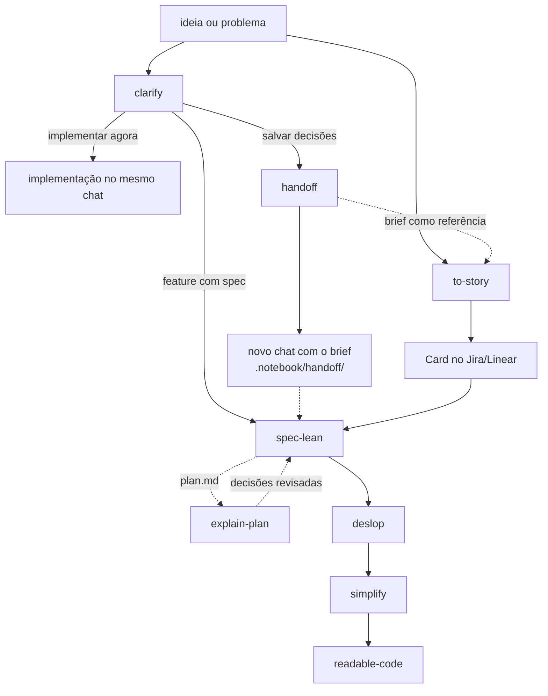

# ia-stuff

Pacote de skills de IA.

As skills trabalham dentro do mesmo ecossistema: uma alimenta a outra, e toda saída que precisa ser gravada vai por padrão para a pasta `.notebook/` na raiz do projeto que as consome. Assim um brief do `handoff` fica num lugar previsível, onde outras skills e sessões podem encontrá-lo. A exceção é o `spec-lean`, que grava seus artefatos em `.specs/`, como na versão oficial.

**Algumas skills são pessoais; outras são forks de skills já existentes, adaptadas para o meu dia a dia.**

## Skills

| Skill | Descrição |
| --- | --- |
| `/clarify` | Entrevista em rodadas (árvore de design + fronteira), até o entendimento compartilhado. |
| `/do-you-understand` | Pede ao agente para reformular com as próprias palavras quais são seus objetivos e o problema que você está tentando resolver, para conferir se ele entendeu antes de agir. |
| `/handoff` | Salva o contexto da conversa atual e as decisões tomadas para você retomar o trabalho num novo chat, com a janela de contexto limpa. Pode ser usado em qualquer conversa, não só depois de um clarify. |
| `/to-story` | Transforma um dump de discovery, texto de agente, card do Jira ou uma ideia de uma linha numa história curta e legível. Depende da `humanizer` para funcionar como esperado. |
| `/explain-pr` | Percorre um PR ou MR como aula, um item por vez: a base, depois cada conceito, depois como as peças se ligam. Explica o que foi feito, não é um code review. |
| `/explain-plan` | Dá um overview didático de um plano ou spec que você passa (caminho ou link), em tópicos com o que está decidido e o que vale revisar, mais os achados novos conferidos no código. É só informativa: não implementa nem edita o plano. |
| `/humanizer` | Reescreve texto com cara de IA para soar como quem escreveu, sem mudar o que o texto diz. |
| `/spec-lean` | Spec Driven Development (SDD): Plan → Checks → Build → Verify, com os artefatos em `.specs/`. |
| `/deslop` | Tira do diff da branch o código com cara de IA (comentários, código que não precisava, etc). |
| `/simplify` | Simplifica o código do diff, focando em abstrações desnecessárias, lógica que já existe em outro lugar do projeto e gargalos de performance. |
| `/readable-code` | Melhora a legibilidade do código que mudou na branch, sem alterar comportamento: aninhamento, nomes, números mágicos, duplicação e comentários que explicam o "o quê". Entrega o plano e só aplica quando você pede. |
| `/test-surgery` | Tira a redundância dos testes, só nos arquivos em que é chamada: testes repetidos viram tabela, setup repetido vira builder e o que não verifica nada sai. Um diff de cobertura linha a linha prova que nenhum comportamento se perdeu, e o resultado sai em tabelas no chat. |

Todas as skills são MIT, exceto `spec-lean`, que mantém a CC-BY-4.0 do original, e `simplify`, adaptado de um comando do Cursor sem licença pública conhecida.

## Layout do `.notebook/`

```
.notebook/
└── handoff/                     # briefs do handoff
    └── dd-mm-yy-theme.md
```

## Layout do `.specs/`

```
.specs/                          # artefatos do spec-lean
├── STATE.md                     # decisões (AD-NNN)
├── LESSONS.md                   # gerado por scripts/lessons.py
├── lessons.json
└── features/<feature>/
    ├── plan.md
    ├── checks.md
    ├── captures/                # fontes vinculantes e <capture>.running.png
    ├── screens.md
    ├── proofs.md                # gerado por scripts/check_proofs.py
    └── verification.md
```

## Fluxo geral



1. **`clarify`** quando a ideia ainda precisa de um entendimento compartilhado.
2. Ao fim do clarify, implemente direto no mesmo chat, use o **`spec-lean`** quando a feature merece plano e prova, ou use o **`handoff`** para continuar em outro chat.
3. **`handoff`** em qualquer conversa atual — uma sessão de clarify ou qualquer outro chat — para abrir um novo chat com o mesmo contexto e as decisões registradas.
4. **`to-story`** para transformar a ideia, um brief do handoff ou um dump de discovery num card no Jira/Linear.
5. **`spec-lean`** para planejar e implementar uma feature de ponta a ponta.
6. **`explain-plan`** para entender e revisar o plano antes de construir: passe o caminho do `plan.md` (ou de outra spec) e revise tópico por tópico. Ela não muda nada; as decisões revisadas voltam para o `spec-lean`.
7. Depois do spec-lean, **`deslop`** para tirar do diff o que tem cara de IA e, em seguida, **`simplify`** para a revisão de qualidade, performance e reuso.
8. **`readable-code`** para deixar esse diff legível sem mudar o comportamento. Ela entrega o plano e só aplica quando você pede.

## Referências

- **`spec-lean`** — fork da skill da [Tech Leads Club](https://github.com/tech-leads-club/agent-skills), sob CC-BY-4.0.
- **`deslop`** — fork do `deslop`, do plugin [cursor-team-kit](https://github.com/cursor/plugins) da Cursor, sob MIT.
- **`simplify`** — adaptado do comando `/simplify` embutido no Cursor.
- **`test-surgery`** — inspirado no [PR #2707 do kentcdodds/kody](https://github.com/kentcdodds/kody/pull/2707).
