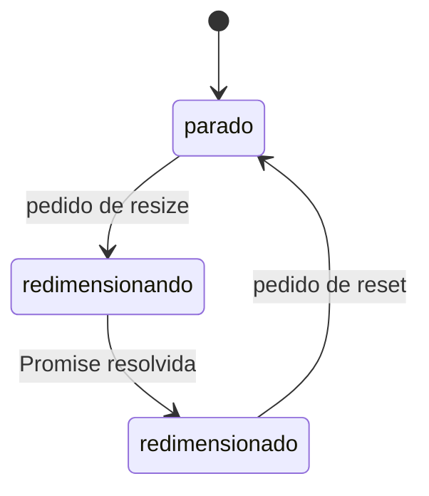

# Explain Plan

Mostrar um plano para que o usuário entenda o que ele define, tópico por tópico. A skill explica; ela não avalia. Não aponte riscos, lacunas, desvios, melhorias nem decisões a reconfirmar. Se o usuário vir algo errado, ele traz, e aí vocês trabalham nisso juntos (veja "Depois do overview").

A skill não implementa, não edita o plano, não escreve nada em disco e não inicia nenhuma etapa seguinte (checks, código, histórias).

Toda a conversa é em português (PT-BR). Os identificadores (arquivos, eventos, funções, options) ficam como estão no código.

Escreva para um colega que esteve fora e está se atualizando: frases completas, nomes reais, sem cadeias de setas (`A → B → falha`) e sem siglas ou apelidos inventados durante a leitura.

## Entrada

O usuário fornece o artefato: o caminho ou o link do plano, da spec, do design doc ou de uma transcrição de conversa.

- Não procure um plano por conta própria. Se o usuário não passou o caminho ou o link, peça e pare.
- Se for uma transcrição, leia para recuperar as decisões e o caminho do plano mais recente. Se a transcrição citar um arquivo de plano, leia esse arquivo também: ele é a fonte da verdade, a conversa é contexto.

## Antes de escrever

1. Leia o artefato inteiro, você mesmo. Ele é o que você vai explicar.
2. Mande para subagentes tudo o que precisar buscar fora do artefato. O chat principal recebe só as respostas, não a busca. Veja "Buscas com subagentes".
3. Busque só o que ajuda a explicar:
   - O estado real: a branch atual, se já existe código da feature e se os artefatos que o plano cita existem (registro de decisões, checks).
   - O que fazem hoje os componentes existentes que o plano usa, para você descrever o ponto de partida com os nomes certos.
4. Não procure problemas no plano. A busca serve para explicar, não para auditar.

## Buscas com subagentes

- Use o subagente `explore` (somente leitura). Lance em paralelo as buscas que não dependem umas das outras.
- Use o modelo padrão (`inherit`). Se o usuário pedir outro modelo e ele não existir na lista disponível, diga isso em vez de trocar por outro.
- No prompt do subagente, passe o caminho do repositório, o caminho do plano e perguntas fechadas. Por exemplo: "O que o `ShoppableAds` faz hoje quando recebe `DID_SHOPPABLE_BUTTON_CLICKED`?", ou "A branch atual tem commits além da `main`?".
- Peça respostas curtas e factuais, com `arquivo:linha`, sem opinião sobre o plano.
- Não repita no chat principal a busca que o subagente já fez. Se uma resposta vier vaga, mande outra pergunta para o subagente.

## Formato da resposta

```markdown
<Um parágrafo de abertura: onde o plano está, o tamanho dele (fatias, critérios), o que
já foi implementado e o que não foi. Se um artefato citado não existe, diga isso em uma
frase, como fato, sem avaliar.>

<Uma frase: "Separei o plano em N tópicos. Em cada um, explico o que o plano define e
como as peças se encaixam.">

---

## 1. A ideia em uma frase

<O que a feature faz, em uma ou duas frases simples.>

<O caminho principal em lista numerada, um passo por linha, com os nomes reais dos
componentes.>

## 2. <Tópico>

<Um ou dois parágrafos explicando o tópico: como funciona, quem faz o quê, e como isso
se liga aos outros tópicos. Quando ajudar, diga o que existe hoje e o que o plano muda.>

**O que o plano define**
- <Uma definição por item, com os nomes e valores literais.>

**Por que assim**
- <A justificativa que o próprio plano dá, incluindo as alternativas que ele rejeitou.
  Só o que está no plano ou no registro de decisões. Omita a seção se o plano não
  justificar.>

## N. <Tópico>
...
```

Termine no último tópico. Sem conclusão, sem ordem de revisão, sem recomendações e sem perguntas.

### Escolhendo os tópicos

Derive os tópicos do plano. Quando o plano encaixa, esta ordem funciona bem:

1. A ideia em uma frase (sempre primeiro)
2. Estrutura: componentes, quem é dono de quê, onde cada coisa fica
3. Contrato: eventos, APIs, payloads, erros
4. Estado e regras: locks, transições, o que é aceito ou recusado
5. Configuração: presets, variantes, padrões, checagens de capacidade
6. Especificidades de plataforma ou ambiente
7. Ciclo de vida e casos de borda: teardown, trocas, interrupções, integração com quem consome
8. Dependências e escopo: bumps, o que entra e o que fica de fora

Junte ou corte tópicos que o plano não tem. Não invente tópico para completar a lista.

### Escrevendo cada tópico

- Explique antes de listar. O parágrafo diz como a peça funciona; a lista guarda os valores literais.
- Uma definição por item. Não repita as tabelas do plano: traga o que o leitor precisa para entender o tópico.
- Fale do plano como ele está escrito. Não diga que algo está certo, errado, faltando ou arriscado.
- Se um trecho é ambíguo e você precisa escolher uma leitura para explicar, diga em uma frase qual leitura usou.

### Diagramas

Use Mermaid quando o conceito fica mais claro desenhado do que escrito: uma máquina de estados, um pedido que atravessa vários componentes, ou quem é dono de quê. Um diagrama pequeno por conceito, dentro do tópico, com rótulos em português. Não desenhe o que uma lista numerada já explica.



## Depois do overview

O usuário costuma voltar tópico a tópico, com dúvidas ou apontando algo que viu.

1. Dúvida: responda em prosa simples. Se a resposta depender do código, pergunte a um subagente antes.
2. O usuário aponta algo que parece errado: aí sim, confira com um subagente e diga o que encontrou, com a evidência. Confirme ou desfaça o ponto. Não aproveite para trazer outros problemas que ele não levantou.
3. Se o ponto exigir uma decisão dele, pergunte no formato abaixo.

Não edite o plano, não escreva arquivos e não proponha começar checks, histórias ou implementação. Se o usuário quiser aplicar as decisões, ele pede isso fora desta skill.

### Perguntas

Pergunte em texto normal, no fim da resposta. Não use `AskQuestion` nem outro popup.

Cada pergunta fica separada das outras, com uma linha em branco depois da pergunta e entre cada opção:

**[Pergunta 1]** <pergunta, citando o tópico>

**a)** <opção>

**b)** <opção>

Regras:
- Numere as perguntas em sequência durante toda a conversa.
- Não use bullets, lista numerada nem bloco de código nas perguntas.
- Pergunte só decisões sobre o ponto que o usuário levantou. Fato, você busca com um subagente.
