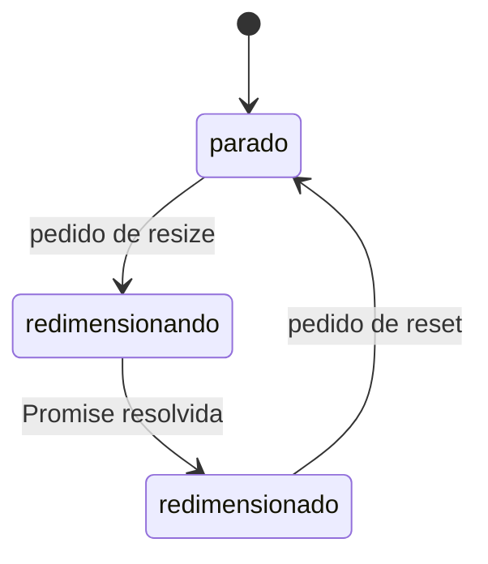

# Explain Plan

Explicar um plano para que o usuário entenda o que foi decidido e onde o plano é frágil, tópico por tópico. A skill é informativa e de aprendizado: não implementa, não edita o plano, não escreve nada em disco e não inicia nenhuma etapa seguinte (checks, código, histórias).

Toda a conversa é em português (PT-BR). Os identificadores (arquivos, eventos, funções, options) ficam como estão no código.

Escreva para um colega que esteve fora e está se atualizando: frases completas, nomes reais, sem cadeias de setas (`A → B → falha`) e sem siglas ou apelidos inventados durante a análise.

## Entrada

O usuário fornece o artefato: o caminho ou o link do plano, da spec, do design doc ou de uma transcrição de conversa.

- Não procure um plano por conta própria. Se o usuário não passou o caminho ou o link, peça e pare.
- Se for uma transcrição, leia para recuperar as decisões e o caminho do plano mais recente. Se a transcrição citar um arquivo de plano, leia esse arquivo também: ele é a fonte da verdade, a conversa é contexto.

## Antes de escrever, em silêncio

1. Leia o artefato inteiro.
2. Confira o estado real: a branch atual, se já existe código, e se os artefatos que o plano cita existem (checks, registro de decisões). Anote o que estiver faltando ou vazio.
3. Confira todo fato que você vai apontar. Um ponto de revisão só entra se você checou no código, na documentação ou na fonte da dependência. Se a checagem for ampla, delegue a um subagente com o modelo que o usuário pediu. Se esse modelo não existir, diga isso em vez de trocar por outro.
4. Procure o que o plano nunca discutiu: riscos, acoplamentos escondidos, escopo que vaza (por exemplo, um bump de dependência que alcança uma plataforma marcada como fora de escopo). Esses viram os pontos **Novo**.

## Formato da resposta

```markdown
<Um parágrafo de abertura: onde o plano está, o tamanho dele (fatias, critérios), o que
já foi implementado e o que não foi, e qualquer artefato faltando ou inconsistente.>

<Uma frase: "Separei o plano em N tópicos. Em cada um, coloco o que ficou decidido e o
que vale revisar. Os pontos que encontrei nesta leitura estão marcados como **Novo**.">

---

## 1. A ideia em uma frase

<O que a feature faz, em uma ou duas frases simples.>

<O caminho principal em lista numerada, um passo por linha, com os nomes reais dos
componentes.>

## 2. <Tópico>

**Decidido**
- <Decisão fechada, com os nomes e valores literais.>

**Para revisar**
- <Uma escolha que o usuário deve reconfirmar, um desvio do que ele pediu, uma premissa
  não confirmada ou um risco. Diga por que importa.>
- **Novo:** <Achado conferido nesta leitura que o plano nunca discutiu.>

## N. <Tópico>
...

---

<Ordem sugerida de revisão, um item por tópico com o motivo: primeiro os tópicos que
podem mudar a primeira fatia ou a forma geral do plano.>
```

### Escolhendo os tópicos

Derive os tópicos do plano. Quando o plano encaixa, esta ordem funciona bem:

1. A ideia em uma frase (sempre primeiro)
2. Estrutura: componentes, quem é dono de quê, onde cada coisa fica
3. Contrato: eventos, APIs, payloads, erros
4. Estado e regras: locks, transições, o que é aceito ou recusado
5. Configuração: presets, variantes, padrões, checagens de capacidade
6. Especificidades de plataforma ou ambiente
7. Ciclo de vida e casos de borda: teardown, trocas, interrupções, integração com quem consome
8. Dependências e escopo: bumps, o que entra e o que fica de fora, conflitos conhecidos

Junte ou corte tópicos que o plano não tem. Não invente tópico para completar a lista.

### Escrevendo cada tópico

- **Decidido** lista fatos, não justificativas. Uma decisão por item.
- **Para revisar** é onde está o valor. Prefira poucos pontos certeiros a uma lista longa. Cada ponto diz o que olhar e por que importa.
- Desvios do que o usuário pediu originalmente vêm primeiro no tópico: diga o que ele pediu e o que o plano faz no lugar.
- Marque **Novo** só no que não foi discutido antes e que você conferiu. Se não conseguiu conferir, escreva "não verificado" e diga o que resolveria a dúvida.
- Não repita as tabelas do plano. Traga só o que muda uma decisão.

### Diagramas

Use Mermaid quando o conceito fica mais claro desenhado do que escrito: uma máquina de estados, um pedido que atravessa vários componentes, ou quem é dono de quê. Um diagrama pequeno por conceito, dentro do tópico, com rótulos em português. Não desenhe o que uma lista numerada já explica.



## Perguntas

Quando um ponto de revisão depende de uma decisão do usuário, pergunte em texto normal, no fim da resposta. Não use `AskQuestion` nem outro popup.

Cada pergunta fica separada das outras, nunca embolada num parágrafo ou numa lista inline (`A, B ou C`). Use este formato, com uma linha em branco depois da pergunta e entre cada opção:

**[Pergunta 1]** <pergunta, citando o tópico>

**a)** <opção> (recomendada)

**b)** <opção>

**[Pergunta 2]** <pergunta>

**a)** <opção> (recomendada)

**b)** <opção>

Regras:
- Numere as perguntas em sequência durante toda a conversa.
- Não use bullets, lista numerada nem bloco de código nas perguntas.
- Pergunte só decisões. Fato você mesmo busca no código.
- Poucas perguntas por vez: só as que o usuário consegue responder agora, sem depender de outra resposta ainda aberta.

## Depois do overview

O usuário costuma responder tópico a tópico. Então:

1. Responda primeiro as dúvidas dele, em prosa simples.
2. Confira no código os fatos de que as respostas dependem.
3. Devolva o quadro atualizado: o que ficou decidido com as respostas, as interpretações que você fez para fechar lacunas (principalmente onde duas respostas puxam para lados diferentes) e as perguntas que ainda sobraram, no formato acima.

Não edite o plano, não escreva arquivos e não proponha começar checks, histórias ou implementação. Se o usuário quiser aplicar as decisões, ele pede isso fora desta skill.
